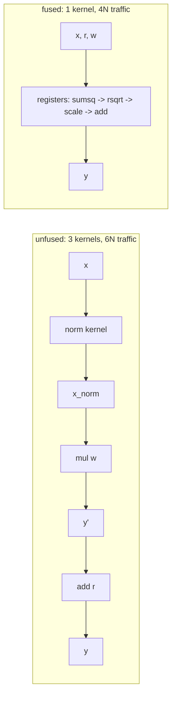

# fusednorm — the last 3 HBM passes of RMSNorm, gone

**One-sentence pitch:** an RMSNorm+residual epilogue has arithmetic intensity near zero, so its runtime *is* its DRAM traffic — fusing three PyTorch kernels into one Triton kernel cuts the traffic from 6N to 4N element-transfers and the latency with it.

## TL;DR (verified)

| | HBM traffic (per [n, hidden] call) | Kernel count |
|---|---|---|
| Unfused PyTorch | 6N·dtype_bytes | 3 |
| **fused Triton** | **4N·dtype_bytes (−33%)** | 1 |

- Kernel ↔ unfused-reference parity: max abs err **0.0039 = one fp16 ULP** (fp32-accumulate identical math)
- Scaled to llama-3-8B decode: **0.5 MB/token saved** at the two norm sites × 32 layers (weights still dominate, but every byte counts at the memory-bound limit)



## Why

A norm does ~4 FLOPs per element against ~6 element-transfers unfused — AI ≈ 0.67, deep in the memory-bound flatland of every roofline. The fused kernel's row lives entirely in registers between the load and the single store; the only remaining traffic is the unavoidable x, r, w reads and y write. The `hbm_bytes()` counter in the API makes the 6N→4N claim checkable without a profiler.

## Quickstart

```bash
pip install -e ".[dev]"
pytest tests/ -q        # 4 tests: parity (1-ULP), byte-model, functional form
python demos/demo.py    # parity + per-model savings receipt
```
On CUDA the kernel compiles natively (`BLOCK` swept by `benchmarks/`); on CPU it runs via the Triton interpreter with identical numerics.
