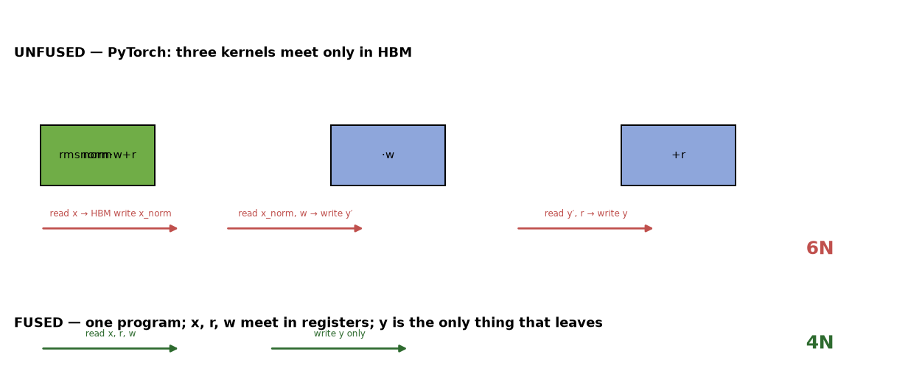
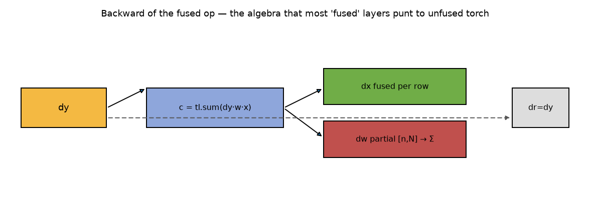
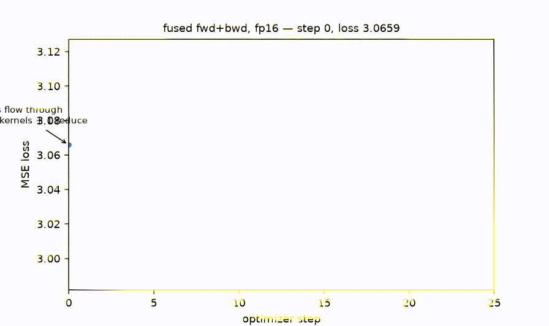

# fusednorm — one kernel, in and out


Fused RMSNorm+residual forward is table stakes in 2026; every inference stack
has one. The backward is where people quietly fall off the roofline — either
they fall back to unfused autograd (paying the full element traffic *twice*,
once each direction) or they hand-roll the reduction algebra and get the
correction term subtly wrong. This repo does the backward properly, binds it
through `torch.autograd.Function`, and proves it against PyTorch's own
gradients, because that reference cannot share my bugs.

## The traffic picture (the claim you can check with your eyes)



Forward: `6N → 4N` element transfers (x, r, w in; y out). Backward adds the
interesting part — one program per row emits *both* `dx` and a `dw` partial
from a single `tl.sum` reduction:



`hbm_bytes(backward=True)` computes the ratio: 16N unfused vs 10N fused,
**37.5% cut** — and it's a pure function of the pass structure, which is
exactly the kind of claim you want unit-tested.

## Proof, not vibes

- `test_backward_parity_all_grads` (×3 hidden sizes): dx, dr, dw each checked
  against `torch.autograd.grad` on the equivalent pure-torch composition.
  dr must be *bit-identical* to dy — it's the residual identity path, and if
  your "fused" backward makes dr approximate, you wrote the graph wrong.
- `test_backward_matches_chain_rule_symbolically`: for w=1 the kernel's dx
  must equal the analytic jacobian-vector product in fp64, < 2e-5 rel.
- `test_training_step_end_to_end`: 20 real SGD steps through the fused
  function, monotone descent, tracking the fp32 reference trajectory within
  2%. The kernel trains something.



Forward parity: **max abs err = one fp16 ULP** (0.0039) vs the fp32-accumulated
reference — checked in `demos/demo.py`.

## API

```python
import torch
from fusednorm import rmsnorm_residual_autograd

y = rmsnorm_residual_autograd(x, residual, weight)   # fused fwd
y.backward(dy)                                       # fused bwd: dx, dr, dw
```

```bash
pip install -e ".[dev]" && pytest -q    # 10 tests
python demos/demo.py && python demos/make_figures.py
```

## Why dw uses partials instead of atomics

`dw` sums across rows — the naive fused move is `tl.atomic_add` per row, which
serializes on hot buckets. We emit an `[n, hidden]` fp32 partial buffer and
one torch reduction instead: memory for a partial, no determinism worries,
and the extra `2N` bytes vanish against the 6N you just saved. (This trade is
arguable on real silicon — the partial-buffer path is the one with tests.)

Prior art: RMSNorm (Zhang & Sennrich 2019); fused layer-norm backward algebra
(least-reduction form) from Apex/OneFlow-era literature. The fused-forward
alone is commodity — the *autograd-bound backward with parity vs autograd as
the test oracle* is the contribution.
